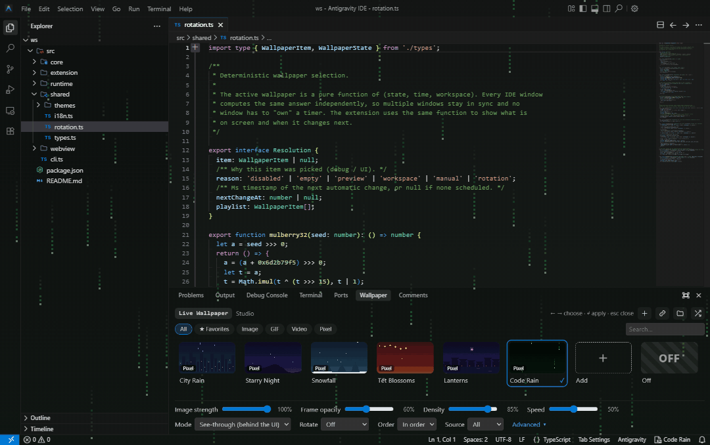
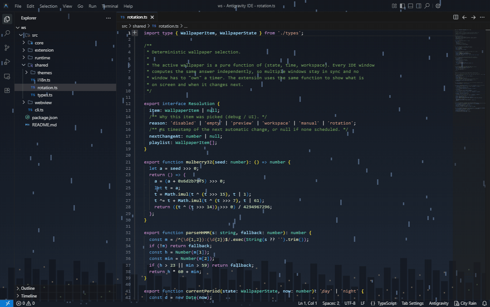

# Live Wallpaper Studio

  

Wallpapers, GIFs, videos and **animated pixel themes** for **VS Code** and **Antigravity IDE** (and other VS Code forks).
Pick one from a visual gallery, **switch instantly without reloading**, and let it rotate on a schedule. Works on Windows, macOS and Linux.

Antigravity IDE, dark theme, *See-through* mode: **Code Rain** (top) and **City Rain** (bottom). Works the same in VS Code.

## Features

- **Visual picker** (`Ctrl+Alt+W`): a thumbnail grid in the panel. Use `← →` to preview live on the IDE, `Enter` to apply, `Esc` to go back to the previous wallpaper.
- **Instant switching**: one reload when you first install. After that, everything (changing the wallpaper, moving a slider, auto-rotation) applies immediately.
- **Your library is a plain folder**: `<Pictures>/IDE Wallpapers` (on Windows the real Pictures folder is used, but OneDrive is skipped; on Linux XDG is respected; otherwise `~/IDE Wallpapers`). Drop a file in and it shows up right away. You can also add files with the ＋ button, drag and drop, or paste a URL.
- **Formats**: PNG, JPG, WebP, BMP, SVG, AVIF, **GIF**, **MP4**, **WebM**, MOV.
- **6 pixel themes drawn in code** (far lighter than a GIF): City Rain, Starry Night, Snowfall, Tết Blossoms, Lanterns, Code Rain. Each has *Density* and *Speed* sliders.
- **Two display modes**:
  - *Overlay*: a faint layer on top of the whole IDE, works with any theme.
  - *See-through*: the wallpaper sits behind the IDE, and the editor, sidebar and terminal become translucent (adjust with *Frame opacity*).
- **Auto-rotation**: every 1 minute to 3 hours, in order or shuffled (no repeats until every image has been shown), optionally only your ★ favorites. All IDE windows always show the same wallpaper.
- **Day / night**: tag images ☀ or ☾ and the IDE switches by the time of day.
- **Per-project wallpapers**: give a project its own wallpaper.
- **Easy on resources**: GIFs freeze and videos/themes pause when the IDE loses focus. The OS *reduce motion* setting is respected. Heavy GIFs can be converted to MP4 with ffmpeg.
- **English and Vietnamese** UI. It follows the IDE display language, or set `wallpaperStudio.language`.

## Keyboard shortcuts

| Action | Windows / Linux | macOS |
|---|---|---|
| Open the picker | `Ctrl+Alt+W` | `⌃⌥W` |
| Next / previous wallpaper | `Ctrl+Alt+]` / `Ctrl+Alt+[` | `⌃⌥]` / `⌃⌥[` |
| Turn the wallpaper on / off | `Ctrl+Alt+0` | `⌃⌥0` |

In the picker: `← → ↑ ↓` preview · `Enter` apply · `Esc` cancel and close · `F` favorite · `Delete` delete · type to search · right-click for more options.

If your keyboard layout uses AltGr (for example German or Polish), `Ctrl+Alt+…` can clash with typing characters. Rebind the keys in *Keyboard Shortcuts* by searching for `wallpaperStudio`.

## Commands

Open the Command Palette (`Ctrl+Shift+P` / `⌘⇧P`) and type **Wallpaper**:

| Command | What it does |
|---|---|
| Open Wallpaper Picker | Show the gallery in the panel (`Ctrl+Alt+W`) |
| Next / Previous / Random Wallpaper | Switch right away |
| Toggle Wallpaper On / Off | Hide or show the wallpaper (`Ctrl+Alt+0`) |
| Quick Menu | Everything in one list (also the status bar button) |
| Add Images / GIFs / Videos… | Copy files into your library |
| Add Wallpaper from URL… | Download an image, GIF or video into your library |
| Open Wallpaper Folder | Open the library folder in your file manager |
| Set Auto-Rotation… | Rotate every 1 minute – 3 hours, in order or shuffled |
| Use Current Wallpaper for This Project / Clear This Project’s Wallpaper | Per-project wallpaper |
| Optimize Heavy GIFs (Convert to MP4) | Needs ffmpeg |
| Install / Repair Runtime | One-time setup (one reload) |
| Remove Runtime and Restore the IDE | Put the IDE back exactly as it was |
| Show Status | Runtime, library and current wallpaper |

## Getting started

1. Install the extension.
2. Click **Install & Reload** in the notification (or run the command `Wallpaper: Install / Repair Runtime`).
3. Done. No more reloads from now on.

If you use the `shalldie.background` extension, its image settings are moved into your library automatically, and its old patch is removed so the two backgrounds don't stack.

### Why "install a runtime"?

VS Code doesn't let extensions draw on the main window. Live Wallpaper Studio adds a small script (~22 KB) to the IDE's UI file **once**. The script contains no image paths: it only reads a settings file (`state.json`) and draws accordingly, so changing wallpapers never touches the IDE's files again.

- The checksum in `product.json` is updated too, so the IDE does **not** report "installation corrupt" (after the first restart).
- The original file is backed up (`*.wallpaper-studio.bak`). The command `Wallpaper: Remove Runtime and Restore the IDE` puts the IDE back exactly as it was, and uninstalling the extension does the same automatically.
- When the IDE **updates itself**, the patch is lost. The extension then offers to *Re-apply* it (1 click).

### Write permissions by OS

| OS | Typical case | What to do |
|---|---|---|
| Windows (user install) | Nothing needed | — |
| Windows (Program Files) | Needs Administrator rights | Click *Copy fix command*, then paste it into PowerShell run as Administrator |
| macOS | Usually nothing needed | If the app belongs to another account: *Copy fix command* (sudo) |
| Linux (.deb / .rpm) | The folder is owned by root | *Copy fix command* (sudo) |
| Linux Snap / Flatpak | Read-only file system | Not supported. Use the .deb / .rpm / .tar.gz build |

## Known limitations

- Panels the IDE draws in their own webview (for example Antigravity's Agent panel) keep their own background in *See-through* mode.
- In *See-through* mode the terminal is only transparent when terminal GPU acceleration is off. The extension asks you once.
- Small GIFs (under ~900×500) use less CPU as GIF than as video (measured). High-resolution GIFs are marked ⚡: converting them to MP4 cuts CPU use by about 35%.

## Settings

| Setting | Default | Meaning |
|---|---|---|
| `wallpaperStudio.libraryPath` | (automatic, see above) | Wallpaper library folder |
| `wallpaperStudio.ffmpegPath` | (search `PATH`) | Path to ffmpeg |
| `wallpaperStudio.statusBar` | `true` | Show the status bar button |
| `wallpaperStudio.autoRepair` | `true` | Offer to reinstall after an IDE update |
| `wallpaperStudio.language` | `auto` | UI language: `auto` (follow the IDE), `en`, `vi` |

## Privacy

No data is collected or sent anywhere. The network is only used when you choose *Add from URL*.

## Feedback & issues

https://github.com/hm4uc/live-wallpaper-studio/issues

## License

MIT
