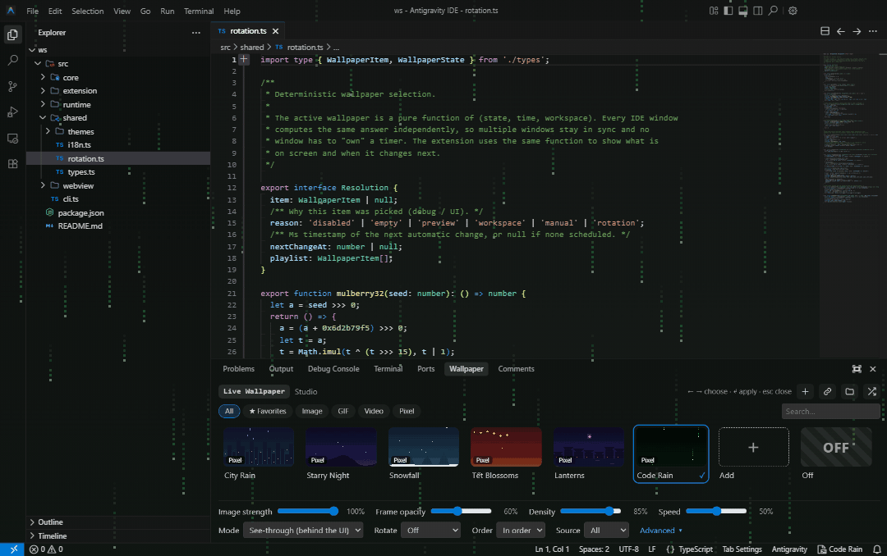
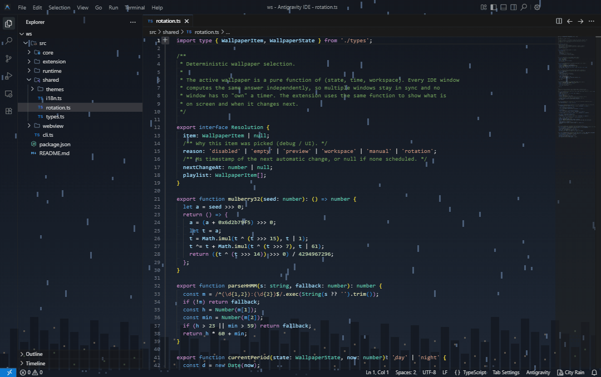
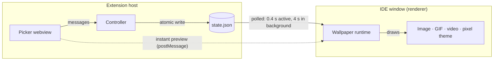

<div align="center">


# Live Wallpaper Studio

**Animated wallpapers for your editor.** Images, GIFs, videos and code-drawn pixel themes for **VS Code** and **Antigravity IDE**, with a visual picker, instant switching and auto-rotation.

[](https://marketplace.visualstudio.com/items?itemName=derekhoang.live-wallpaper-studio)
[](https://open-vsx.org/extension/derekhoang/live-wallpaper-studio)
[](https://open-vsx.org/extension/derekhoang/live-wallpaper-studio)
[](https://github.com/hm4uc/live-wallpaper-studio/stargazers)
[](https://github.com/hm4uc/live-wallpaper-studio/actions/workflows/ci.yml)
[](LICENSE)

[**Install for VS Code**](https://marketplace.visualstudio.com/items?itemName=derekhoang.live-wallpaper-studio) ·
[**Install for Antigravity / Cursor / VSCodium**](https://open-vsx.org/extension/derekhoang/live-wallpaper-studio) ·
[Report a bug](https://github.com/hm4uc/live-wallpaper-studio/issues/new) ·
[Changelog](CHANGELOG.md)



</div>

> [!TIP]
> If Live Wallpaper Studio makes your editor a nicer place, please **⭐ star the repo**. It helps other people find it.

## Table of contents

- [Why Live Wallpaper Studio?](#why-live-wallpaper-studio)
- [Features](#features)
- [Pixel themes](#pixel-themes)
- [Installation](#installation)
- [Quick start](#quick-start)
- [Keyboard shortcuts](#keyboard-shortcuts)
- [Settings](#settings)
- [How it works](#how-it-works)
- [FAQ & troubleshooting](#faq--troubleshooting)
- [Development](#development)
- [Contributing](#contributing)
- [License](#license)

## Why Live Wallpaper Studio?

Most background extensions for VS Code make you paste image paths into `settings.json`, then reload the window and dismiss an "installation corrupt" warning every time you change the picture. Live Wallpaper Studio fixes that:

| | Typical background extension | **Live Wallpaper Studio** |
|---|---|---|
| Change the wallpaper | Edit `settings.json`, then reload | Click a thumbnail. It changes **instantly** |
| Preview before applying | ✗ | `← →` previews live on the whole IDE |
| Animated wallpapers | Heavy GIFs only | GIF, MP4/WebM **and** lightweight pixel themes drawn in code |
| "Installation corrupt" warning | After every change | Never after the first restart (checksum kept in sync) |
| Multiple windows | Each window on its own | All windows show the same wallpaper, in sync |
| Battery | Keeps animating | Pauses when the IDE isn't focused |
| Uninstall | May leave the IDE patched | Restores the IDE byte for byte |

## Features

- 🖼️ **Visual picker.** A thumbnail grid in the sidebar — click the wallpaper icon in the Activity Bar or press `Ctrl+Alt+W` with live preview, search, filters and favorites.
- ⚡ **Instant switching.** Reload once at setup. After that, every change applies immediately.
- 🎞️ **Every common format.** PNG, JPG, WebP, BMP, SVG, AVIF, **GIF**, **MP4**, **WebM**, MOV.
- 👾 **6 pixel themes drawn in code.** Far lighter than a GIF, with *Density* and *Speed* sliders.
- 🪟 **Two display modes.** *Overlay* puts a faint layer over everything. *See-through* puts the wallpaper behind the IDE and makes the editor, sidebar and terminal translucent. Works with dark and light themes.
- 🔁 **Auto-rotation.** Every 1 minute to 3 hours, in order or shuffled (no repeats until every image has been shown), optionally only ★ favorites.
- 🌗 **Day / night playlists.** Tag images ☀ or ☾ and the IDE switches by the time of day.
- 📁 **Per-project wallpapers.** Each project can have its own wallpaper.
- 📂 **Your library is a plain folder.** Drop files in, drag and drop into the picker, or paste a URL.
- 🔋 **Easy on resources.** GIFs freeze and videos and themes pause when the IDE loses focus. The OS *reduce motion* setting is respected. Heavy GIFs convert to MP4 with ffmpeg in one click.
- 🌍 **English & Tiếng Việt.** The UI follows the IDE display language.
- 💻 **Windows, macOS, Linux.** Tested in CI on all three.

<div align="center">

<sub><i>City Rain in See-through mode, Antigravity IDE dark theme.</i></sub>
</div>

## Pixel themes

Drawn on a quarter-resolution canvas at 15 fps, so they cost a fraction of a GIF.

| Theme | Scene |
|---|---|
| 🌧️ **City Rain** | Rain falling over a night skyline with lit windows |
| ✨ **Starry Night** | Twinkling stars and the occasional shooting star |
| ❄️ **Snowfall** | Snow drifting down over pine trees |
| 🌼 **Tết Blossoms** | A branch of yellow apricot blossoms for Lunar New Year |
| 🏮 **Lanterns** | Hội An lanterns glowing over old-town rooftops and the river |
| 💚 **Code Rain** | Falling green glyphs |

## Installation

| Editor | How |
|---|---|
| **VS Code** | [Visual Studio Marketplace](https://marketplace.visualstudio.com/items?itemName=derekhoang.live-wallpaper-studio), or `code --install-extension derekhoang.live-wallpaper-studio` |
| **Antigravity IDE** | Search **Live Wallpaper Studio** in the Extensions view ([Open VSX](https://open-vsx.org/extension/derekhoang/live-wallpaper-studio)) |
| **Cursor, VSCodium, Windsurf, other forks** | [Open VSX](https://open-vsx.org/extension/derekhoang/live-wallpaper-studio), or install the `.vsix` from [Releases](https://github.com/hm4uc/live-wallpaper-studio/releases) |

## Quick start

1. Install the extension.
2. Click **Install & Reload** in the notification. This adds the small wallpaper runtime to the IDE, once.
3. Press `Ctrl+Alt+W`, move through the thumbnails with `← →` and press `Enter` to apply.

Using `shalldie.background`? Its images are imported automatically and its patch is removed, so the two backgrounds never stack.

## Keyboard shortcuts

| Action | Windows / Linux | macOS |
|---|---|---|
| Open the picker | `Ctrl+Alt+W` | `⌃⌥W` |
| Next / previous wallpaper | `Ctrl+Alt+]` / `Ctrl+Alt+[` | `⌃⌥]` / `⌃⌥[` |
| Turn the wallpaper on / off | `Ctrl+Alt+0` | `⌃⌥0` |

Inside the picker: `← → ↑ ↓` preview · `Enter` apply · `Esc` cancel · `F` favorite · `Delete` remove · type to search · right-click for more.

## Settings

| Setting | Default | Description |
|---|---|---|
| `wallpaperStudio.libraryPath` | automatic | Library folder (`<Pictures>/IDE Wallpapers`, skipping OneDrive, or `~/IDE Wallpapers`) |
| `wallpaperStudio.ffmpegPath` | search `PATH` | ffmpeg, used to optimize heavy GIFs |
| `wallpaperStudio.statusBar` | `true` | Show the status bar button |
| `wallpaperStudio.autoRepair` | `true` | Offer to re-apply after an IDE update |
| `wallpaperStudio.language` | `auto` | `auto`, `en` or `vi` |

## How it works

VS Code doesn't let extensions draw on the main window, so a tiny runtime (~22 KB) is added **once** to the IDE's UI bundle. It holds no image paths. It reads a small state file and renders from it, so changing wallpapers never touches the IDE again.



- **Deterministic rotation.** What's on screen is a pure function of *(state, time, project)*, so every window computes the same answer with no shared timer.
- **Safe patching.** The original file is backed up, the `product.json` checksum is kept in sync, and uninstalling restores the exact original bytes.
- **Self-repair.** When the IDE updates and the patch is gone, the extension offers to re-apply it in one click.

## FAQ & troubleshooting

<details>
<summary><b>The IDE says the installation is corrupt.</b></summary>

That only happens on the first reload after installing the runtime, because the IDE cached the old checksum. Restart the IDE once and the warning is gone for good: the checksum is kept in sync.
</details>

<details>
<summary><b>The wallpaper disappeared after an IDE update.</b></summary>

Updates replace the IDE's files. Click **Re-apply** in the notification, or run `Wallpaper: Install / Repair Runtime`.
</details>

<details>
<summary><b>"Can't write the IDE's files" (EPERM / EACCES).</b></summary>

The IDE is installed for all users (Program Files, `/usr/share`, another macOS account). Click **Copy fix command** and run it in an elevated terminal. Snap and Flatpak builds are read-only and not supported: use the .deb / .rpm / .tar.gz build.
</details>

<details>
<summary><b>The terminal isn't transparent in See-through mode.</b></summary>

The terminal's GPU renderer paints an opaque background. The extension offers once to set `terminal.integrated.gpuAcceleration` to `off`.
</details>

<details>
<summary><b>How do I remove everything?</b></summary>

Run `Wallpaper: Remove Runtime and Restore the IDE`, or just uninstall the extension: the wallpaper turns off within a few seconds, and the IDE's files are restored (backups included) the next time you quit and reopen the IDE. Your image folder is left untouched.
</details>

## Development

```bash
git clone https://github.com/hm4uc/live-wallpaper-studio.git
cd live-wallpaper-studio
npm ci
npm run build      # bundle with esbuild into dist/
npm test           # vitest
npm run typecheck
code --extensionDevelopmentPath="$PWD"   # try it in a development window
```

```text
src/
├── extension/   # activation, commands, controller, picker provider, uninstall hook
├── webview/     # the picker UI
├── runtime/     # code injected into the IDE window (renders the wallpaper)
├── core/        # patcher, library scanner, media helpers (Node only, unit-tested)
└── shared/      # state types, rotation logic, pixel themes, i18n
```

Releases are automated. `npm run release:patch` (or `minor` / `major`) bumps the version and pushes a tag. GitHub Actions then publishes to the VS Code Marketplace and Open VSX and creates a GitHub Release.

## Contributing

Bug reports, ideas and pull requests are welcome. For larger changes, please [open an issue](https://github.com/hm4uc/live-wallpaper-studio/issues) first. New pixel themes are especially welcome: see `src/shared/themes/`.

## Star history

<a href="https://star-history.com/#hm4uc/live-wallpaper-studio&Date">
  
</a>

## License

[MIT](LICENSE) © derekhoang
